# ScreenLookup - Screen & VR Translation

ScreenLookup is a **Screen** & **VR** tool for learning foreign language vocabulary through translation. It extracts text from the image using OCR. Provides translation, alternative meanings, phonetic, and Text-To-Speech.

[Download Latest Release](https://github.com/chaixshot/ScreenLookup/releases)

## Features & Highlights

* **Desktop Screen & VR Capture**: Perform OCR on any selected desktop area or hand gestures in SteamVR to make a capture frame.
* **Rich Dictionary & Alternative Meanings**: Click any word to view primary translations plus parts of speech (`noun`, `verb`, `adjective`) and alternate meanings.
* **OCR & Hunspell Correction**: High-accuracy optical character recognition with optional Hunspell dictionary spell-correction for stylized game fonts.
* **Text-To-Speech**: Listen to native audio pronunciations for source words and translated sentences.
* **Dual Display Modes**:
  * **On Image**: Places interactive, clickable word boxes directly over the captured image.
  * **On Line**: Displays a clean, structured text list.
* **History & Vocabulary Management**:
  * **History**: Automatically records previous captures and translations.
  * **Saved Words**: Bookmark new vocabulary and track your review priority scores.
* **Multiple Translation Engines**: Switch between Google, Google New, Bing, Microsoft Azure, Yandex, local LLM, and cloud LLM.

## Prerequisites

* **OS**: Windows 10 / Windows 11 (64-bit)
* **Runtime**: [.NET 10 Desktop Runtime](https://dotnet.microsoft.com/)
* **VR Headset (Optional)**: SteamVR compatible VR headset.

## Getting Started

1. **Configure Languages & Download Models**:
   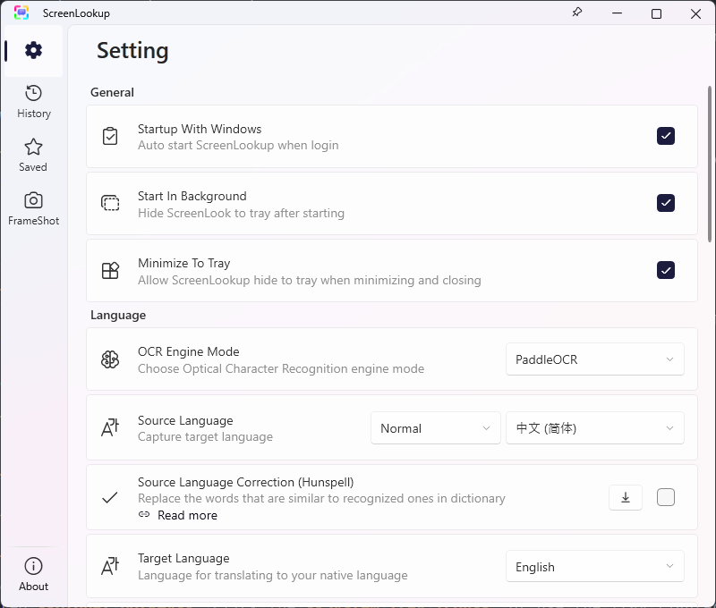
   * Open the **Settings** page.
   * Select your **Source Language** and accuracy level, then click **Download** to acquire OCR model data.
   * *(Optional)* Download **Hunspell** for spell correction if supported by your source language to fix game font OCR artifacts.
   * Select your **Target Language**, **Translation Provider**, and **TTS Provider**.

2. **Choose Lookup Display Method**:
   * **Capture Screen**  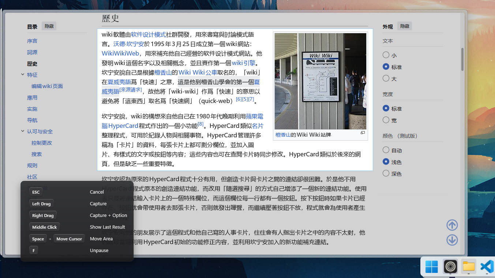
   * **On Image**: Overlays interactive text blocks directly over the screenshot.
       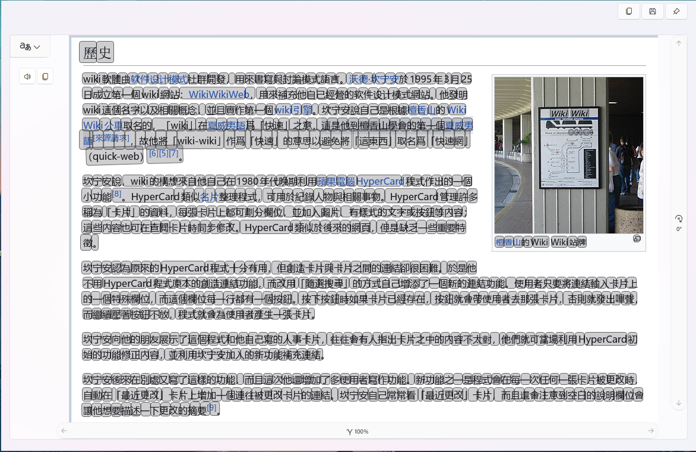 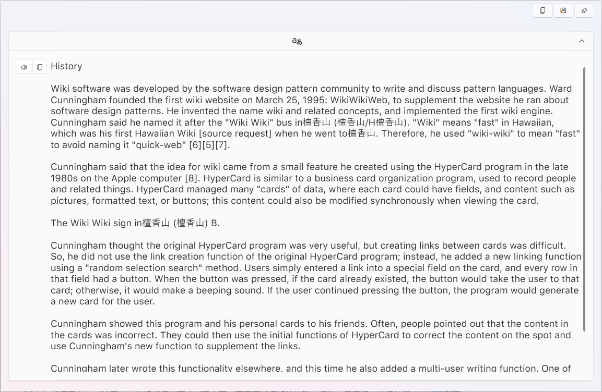
   * **On Line**: Places all words neatly into a text box.
       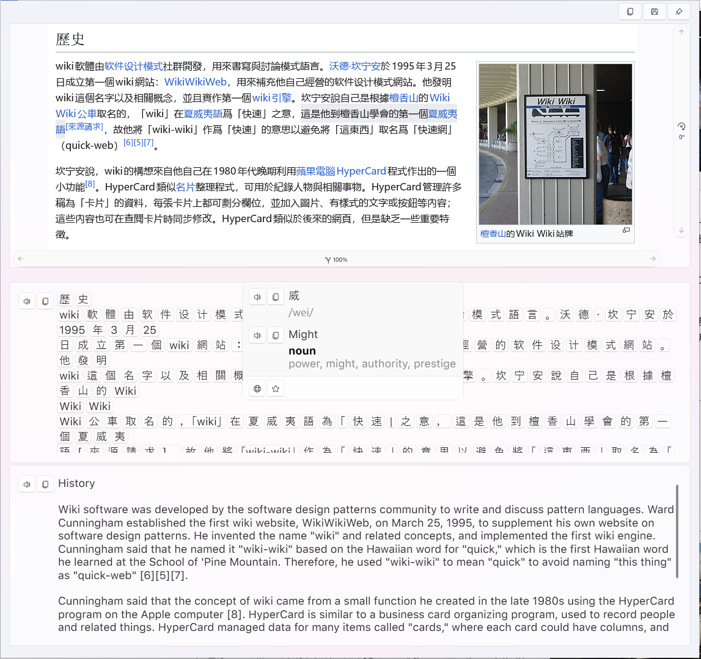

3. **Perform Desktop Lookup**:
   * Press your configured **Global Hotkey** or click the **Tray Icon** to start desktop capture.
   * Click any word in the result window to open the **Word Flyout** for dictionary definitions, alternative meanings, audio playback, and saving vocabulary.
    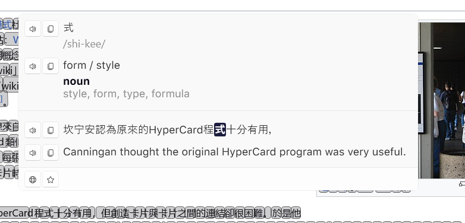

## History

The **History** page automatically logs every screen lookup capture, full-sentence translation, and OCR word result for instant review and study.

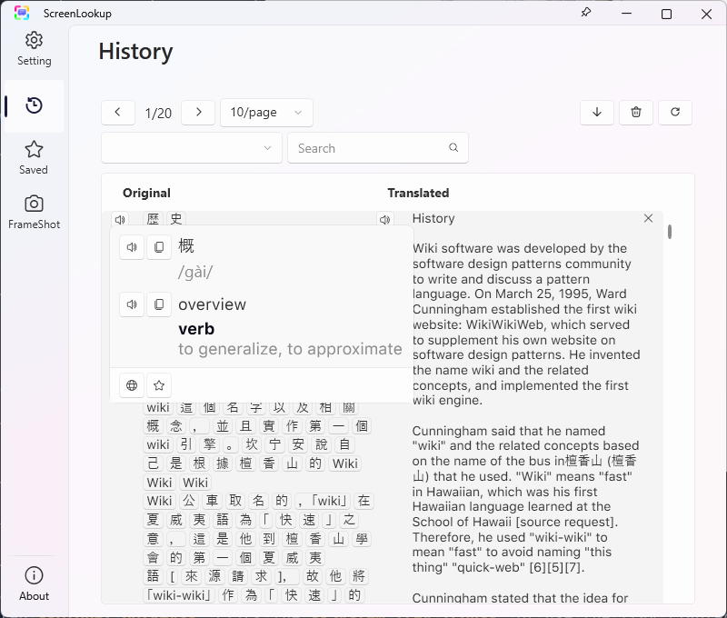

* **Interactive OCR Word Cards**: Hover over any captured sentence in the **Original** column to reveal individual interactive word cards. Click any word to trigger the **Word Flyout**.
* **Audio Pronunciation**: Independent Text-To-Speech speaker buttons for full captured sentences and translations.
* **Instant Search & Language Filtering**: Search history entries in real-time or filter captures by **Source Language**.
* **One-Click Re-Translation**: Re-translate past captured text if the primary translation provider failed or if settings were changed.
* **Export & Management**: Export complete lookup history to CSV for external study or clear logs with one click.

## Saved

The **Saved Words** allows you to build, review, and manage your personal vocabulary list saved during screen lookups.

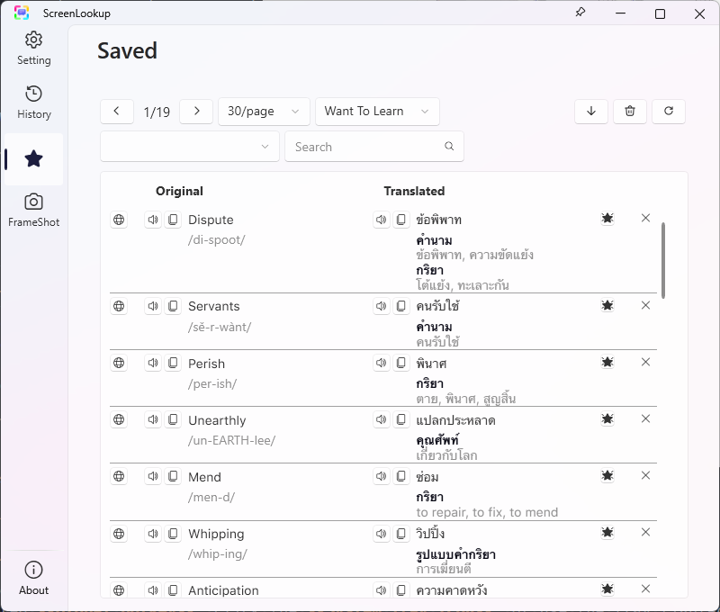

* **Word Dictionary Flyout**: Click any word in the **Original** column to pop up the **Word Flyout** worfor interactive definitions and audio playback.
* **Inline Extra Meanings**: Displays parts of speech and alternative dictionary meanings directly under the **Translated** column when available.
* **Priority Ranking ("Want To Learn")**: Sort words by priority score (`Want To Learn`) or addition date (`Added Time`). Incrementing a word's score moves it to the top of your review queue when encountered repeatedly.
* **Audio Pronunciation**: Independent Text-To-Speech speaker buttons for both source words and target translations.
* **Online Dictionary Lookup**: Click the browser button on any word entry to open external web dictionary searches.
* **Filtering & Real-Time Search**: Filter vocabulary entries by **Source Language** or use the instant search auto-suggest box.
* **Export Data**: Export your saved vocabulary list to CSV format for Anki/flashcard import or external study.

## FrameShot (VR Capture)

ScreenLookup includes native **SteamVR / OpenVR** integration allowing you to capture, crop, and read translations inside VR games using intuitive controller hand gestures.

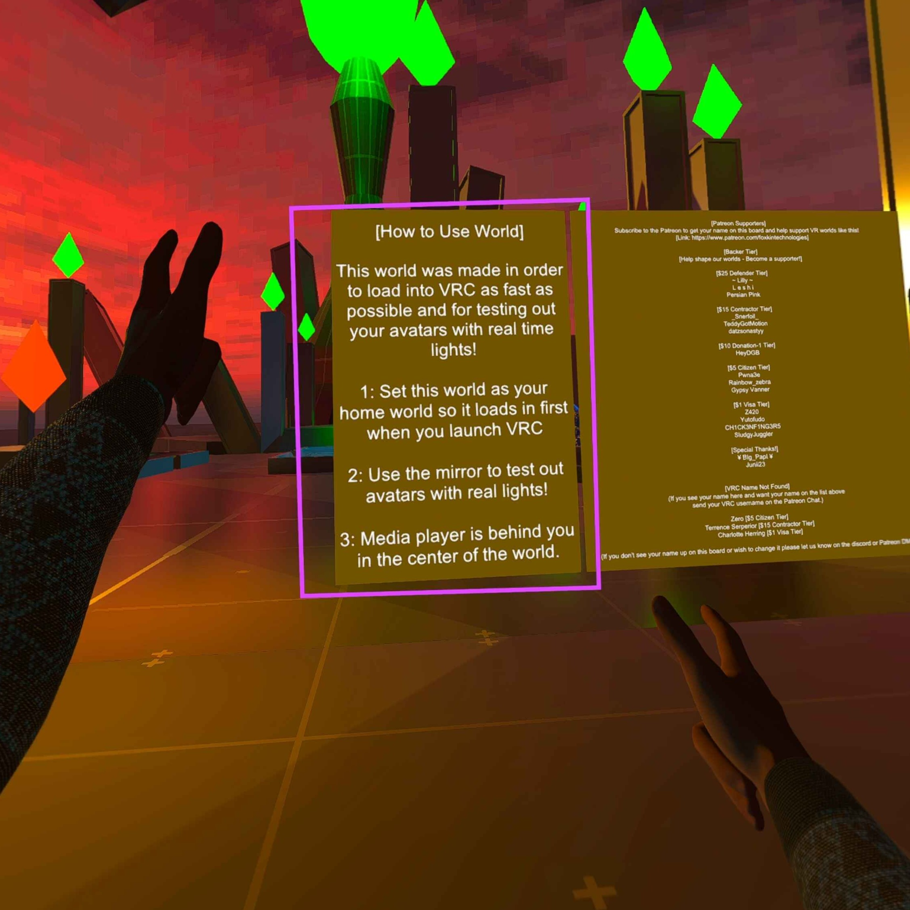 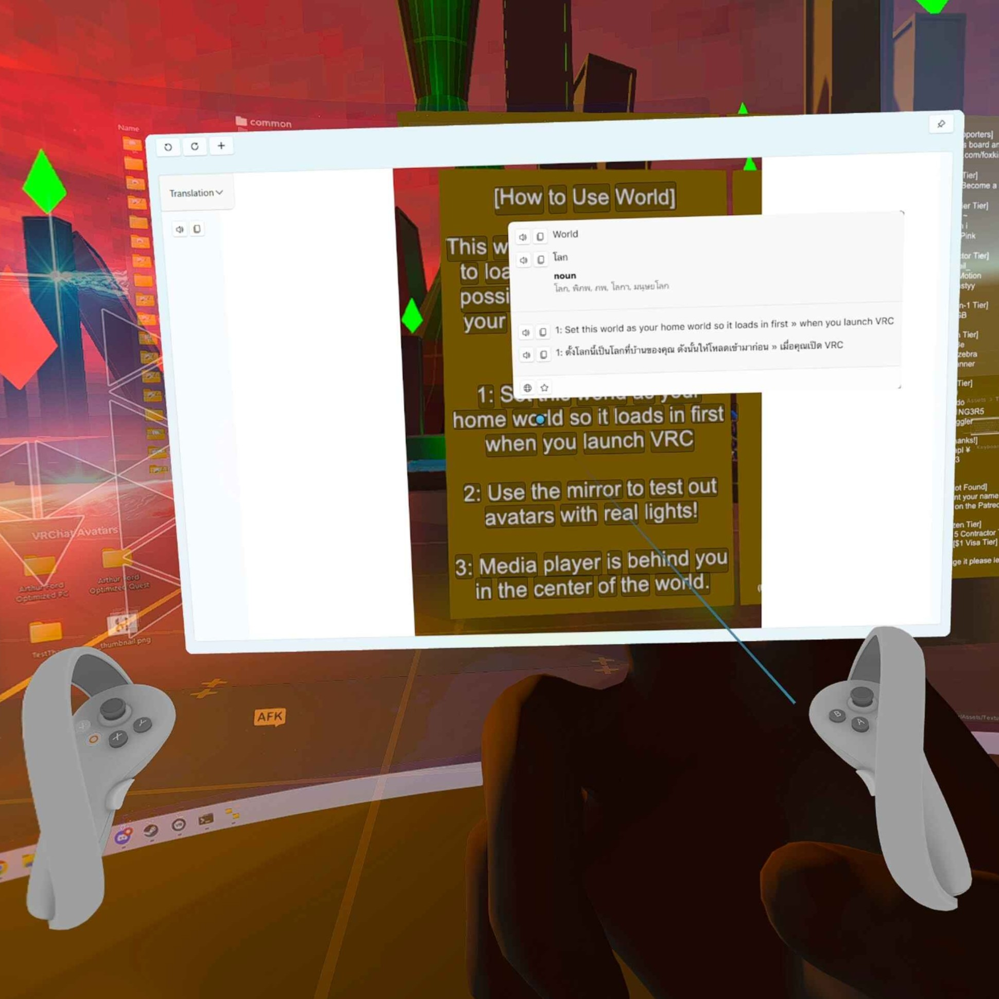 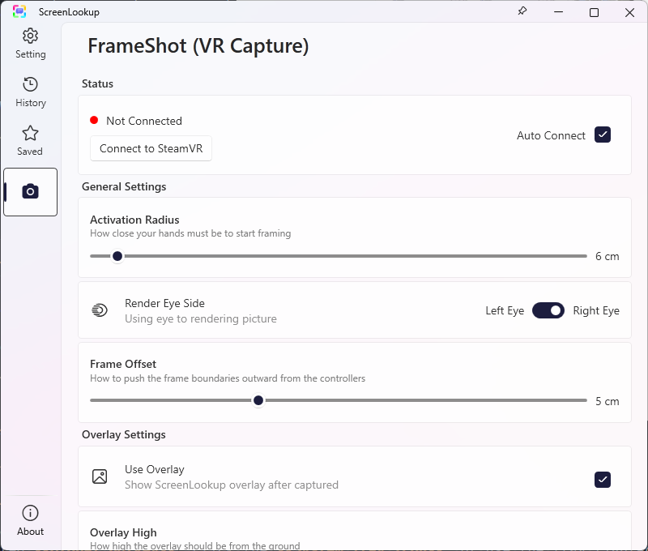

### SteamVR Setup

* Connect directly to **SteamVR** from the **FrameShot** page.
* Select **Render Eye Side** to choose the eye side projection to capture.

### VR Gestures & Controls

1. Bring both VR controllers together in **Activation Radius**.
1. Hold **both Grip** buttons for half second.
1. Pull hands apart to create the capture frame.
   * Release **Right Grip** to capture, **Left Grip** to **cancel**.
   * Holding **Left Trigger**, then capture to **show options**.
   * Press **Right Trigger** to show the **last result**.
1. ScreenLookup overlay
   * Press **Trigger** to click.
   * Press **A/X** to close.
   * Press **B/Y** to recenter.
   * Press **Grip** to grab the overlay to control overaly Distance and High.
   * While grabbing, hold **Trigger** and **push/pull** controller to scaling.
   * While grabbing, **push/pull** Thumbstick to control overaly Distance.

## Troubleshooting & Tips

### OCR Inaccuracies or Misread Fonts

* **Use Image Editing Toolbar**:
  * Use **Rotate Left / Rotate Right** if captured text is vertical or sideways.
  * Use **Zoom** to enlarge tiny or low-resolution text for clearer character recognition.
  * Click **Confirm** after adjusting to re-run OCR on the modified image.
* Increase the **Source Language Accuracy** level in Settings.
* Enable **Hunspell** for supported languages to correct OCR misspellings automatically.

### Fullscreen Game Capture Issues

* If the captured screen is black or frozen, switch the game from *Exclusive Fullscreen* to *Windowed* or *Borderless Windowed* mode.

---

## Credits

* **[Tesseract OCR](https://github.com/charlesw/tesseract)**: Optical Character Recognition engine for text extraction.
* **[PaddleOCRSharp](https://github.com/raoyutian/PaddleOCRSharp)**: Optical Character Recognition engine for text extraction.
* **[HunspellSharp](https://github.com/Tomi-A/HunspellSharp)**: Spell checking and dictionary correction engine.
* **[GTranslate](https://github.com/Hexed2/GTranslate)**: Multi-provider translation and Text-To-Speech library.
* **[WPF-UI](https://github.com/lepoco/wpfui)**: Modern Fluent UI design system and Mica backdrop controls.
* **[NAudio](https://github.com/naudio/NAudio)**: Audio rendering library for dynamic audio output routing.
* **[Vortice.Windows](https://github.com/amerkoleci/Vortice.Windows)**: DirectX 11 wrappers for desktop frame capturing.
* **[OpenVR](https://github.com/ValveSoftware/openvr)**: Valve OpenVR SDK for SteamVR 3D controller tracking and overlays.
* **[HotkeyUtility](https://github.com/iPylum/HotkeyUtility)**: Global hotkey management library.
* **[WpfScreenHelper](https://github.com/micdenny/WpfScreenHelper)**: Multi-monitor display helper for WPF.
* **[Porter2Stemmer](https://github.com/micdenny/WpfScreenHelper)**: An implementation of the Porter2 stemming algorithm in C#.
